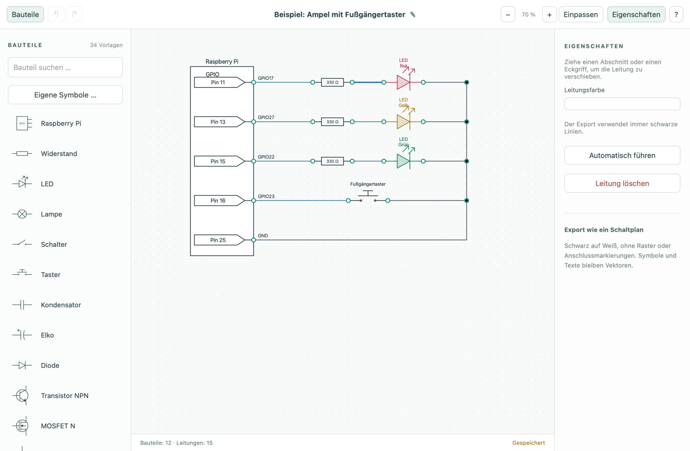

# PiWire 2.2.0

PiWire is a desktop editor for drawing Raspberry Pi GPIO schematics. Place components, connect pins, adjust wire routes, and share the result as an editable project, PDF, or SVG. The editor works offline. The interface and introductory tour are available in German and English.

[Download the latest release](https://github.com/LordSteini/PiWire/releases/latest) · [German user guide](docs/handbuch.md) · [Release notes](docs/piwire-2.2.0.md)



## Install

| Platform | PiWire 2.2.0 package | How to start |
| --- | --- | --- |
| macOS 13+ on Apple Silicon or Intel | [Universal DMG](https://github.com/LordSteini/PiWire/releases/download/v2.2.0/PiWire-2.2.0-macOS-universal.dmg) | Drag PiWire into Applications, then open it there. |
| Windows 10/11 x64 | [Portable ZIP](https://github.com/LordSteini/PiWire/releases/download/v2.2.0/PiWire-2.2.0-Windows-x64.zip) | Extract the whole folder and open `PiWire.exe`. |
| Linux desktop x86-64 | [Portable TAR.GZ](https://github.com/LordSteini/PiWire/releases/download/v2.2.0/PiWire-2.2.0-Linux-x64.tar.gz) | Extract the folder and run `./start-piwire.sh` as your regular user in a graphical session. |

[SHA-256 checksums](https://github.com/LordSteini/PiWire/releases/download/v2.2.0/SHA256SUMS.txt) · [Apple’s guide to opening an app on macOS](https://support.apple.com/en-us/102445)

## First schematic

The seven-step tour uses an **editable traffic light with three LEDs, a pedestrian button, and a shared ground**. Use **End Tour** or **Esc** at any step. After the first tour, the example stays open for editing. Replay it from **Settings → Start Introduction** and return to your current project afterward. On later starts, **New Schematic** opens with the Raspberry Pi and all 40 physical header pins.

[Editable traffic light](Source/Beispiel-Ampel.piwire) · [Simpler LED example](Source/Beispiel-LED.piwire) · [Sample SVG export](Source/Beispiel-Schaltplan.svg)

| Introduction | Custom symbol editor |
| --- | --- |
|  |  |

## Features

- **GPIO layout.** Choose physical header pins individually or as ranges. The editor shows GPIO and alternate-function labels and aligns terminals to the grid.
- **Routing and junctions.** Connect terminals, place corners on the grid, drag wire segments or corner handles, and connect to an existing wire to create a junction. Shift-click starts from an existing wire. Automatic routing looks for separate tracks and uses a gap to mark unconnected crossings.
- **Component editing.** Use 34 built-in templates including resistors, LEDs, passive parts, relays, switches, power sources, test instruments, and GPIO modules. Resistance appears inside the symbol. Customize LED colors and hide component names or values independently.
- **Own symbols.** Draw lines, rectangles and ellipses, then place named terminals. Save symbols in the local palette, share editable `.piwire-symbol` files, or export a vector SVG. Projects carry the geometry of custom symbols they use.
- **Workspace.** Collapse the palette and inspector, rename a project by clicking its title, copy and paste components, and undo or redo edits. Native menus group file actions, view controls and help.
- **Project files and exports.** Save an editable `.piwire` project or create a monochrome A4 PDF or SVG. On macOS, PiWire registers as an editor for its project files and provides a document icon plus a Quick Look thumbnail extension.
- **Settings and help.** Switch between German and English, control GitHub update checks, reopen the tour, or browse the help by topic.

PiWire is a drawing tool. The reference for pinouts and electrical limits is the datasheet of the board or component you are using. The palette uses IEC-style symbols.

## Build from source

The shared editor lives in [`Source/web/`](Source/web/). macOS uses Swift and system WebKit. The Windows and Linux builds bundle a pinned Electron runtime.

```sh
cd Source
node test.cjs
python3 build.py mac
python3 build.py windows
python3 build.py linux
```

The macOS build requires the Xcode Command Line Tools. `python3 build.py mac-dev` builds a separate local test app. Windows and Linux builds verify the Electron archive checksum. To stage release artifacts, run `python3 package.py <mac|windows|linux> ../release-assets` after each build.

[MIT License](LICENSE)
