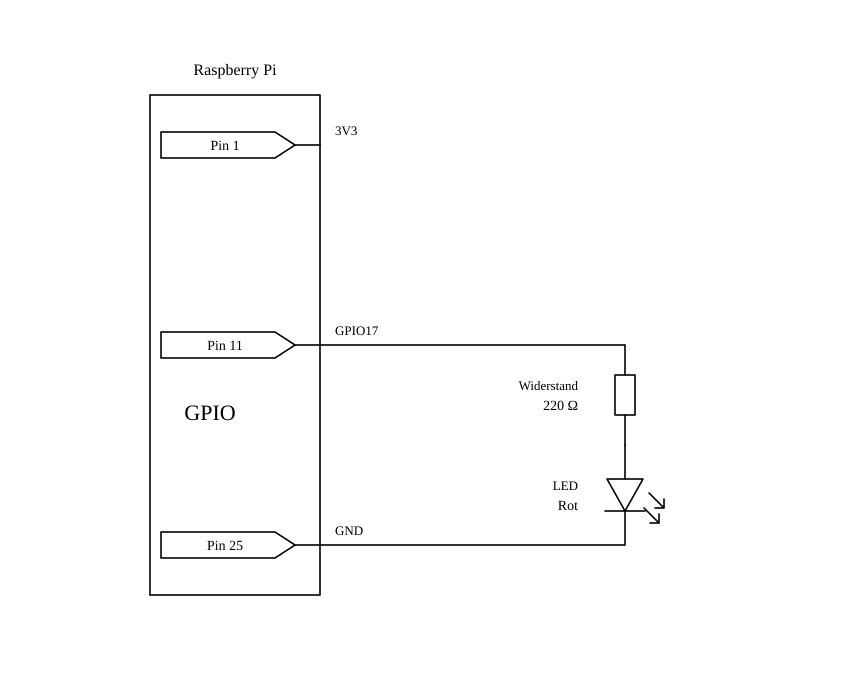

# PiWire

**Draw, document, and share Raspberry Pi GPIO wiring diagrams.**

PiWire is an offline desktop schematic editor for Raspberry Pi projects with a standard 40-pin header. Drop components onto the canvas, connect their pins, and export a clean vector diagram for a build guide or project README. The editor is available in German and English.

[Download PiWire](https://github.com/LordSteini/PiWire/releases/latest) · [Open the LED example](Source/Beispiel-LED.piwire) · [View the SVG export](Source/Beispiel-Schaltplan.svg)



## Downloads

| Platform | Download | How to start | Test status |
| --- | --- | --- | --- |
| macOS 13+ · Apple Silicon and Intel | [Universal DMG](https://github.com/LordSteini/PiWire/releases/download/v2.1.0/PiWire-2.1.0-macOS-universal.dmg) | Open the disk image and drag `PiWire.app` into Applications. See [first launch on macOS](#first-launch-on-macos) if prompted. | App launch and editor tested on Apple Silicon |
| Windows 10/11 · x64 | [Windows ZIP](https://github.com/LordSteini/PiWire/releases/download/v2.1.0/PiWire-2.1.0-Windows-x64.zip) | Extract the whole archive and open `PiWire.exe`. | Launch test pending |
| Linux desktop · x86-64 | [Linux TAR.GZ](https://github.com/LordSteini/PiWire/releases/download/v2.1.0/PiWire-2.1.0-Linux-x64.tar.gz) | Extract the archive and run `./start-piwire.sh` from the extracted directory. | 2.1.0 launch test pending (2.0.1 launched on Zorin OS) |

All three builds report version **2.1.0** and share the same editor and project format. PiWire can check GitHub for updates at startup. Choose the interface language and manage update checks in Settings. Linux requires an x86-64 desktop with Chromium runtime libraries and sandbox support. Raspberry Pi OS on ARM is outside the supported download targets.

### First launch on macOS

1. Download and open the macOS DMG, drag `PiWire.app` into Applications, and open it there. If you previously installed `PiWire 2.app`, quit it and remove the old bundle before opening the new version.
2. If macOS blocks PiWire because the developer cannot be verified, open **System Settings → Privacy & Security** (**Systemeinstellungen → Datenschutz & Sicherheit**).
3. In the **Security** section, click **Open Anyway** (**Dennoch öffnen**) for PiWire and confirm the prompt. macOS remembers this exception for the app.

[Apple’s guide to opening apps on macOS](https://support.apple.com/en-us/102445)

## Draw your first diagram

1. Open `Beispiel-LED.piwire` with **Öffnen**, or choose a component from the palette to start from scratch.
2. Click one pin and then another to connect them. Click the grid in between to add bends, or press **Esc** to cancel.
3. Use the right sidebar to edit names and values. Press **R** to rotate a selected component.
4. Save the editable `.piwire` file or export it as **PDF** or **SVG**.

PiWire includes **26 component templates** and supports custom modules with up to 40 connectors. The GPIO block shows physical pin numbers and BCM functions. Choose which pins appear to keep small diagrams readable. SVG and single-page A4 PDF exports use black vector symbols on a white background.

PiWire draws schematics. For voltage, current limits, and pin assignments, check your board and module datasheets.

## Build from source

The shared editor lives in [`Source/web/`](Source/web). macOS uses Swift and system WebKit. Windows and Linux use Electron.

```sh
cd Source
node test.cjs
python3 build.py mac
python3 build.py windows
python3 build.py linux
```

Run only the build command for the platform you want to package. The macOS build needs Xcode Command Line Tools. Windows and Linux packaging downloads the pinned Electron runtime and verifies its SHA-256 checksum. Build output goes to `Source/build/`. To create a release archive after building, run `python3 package.py windows ../dist` or `python3 package.py linux ../dist`. The macOS build produces the DMG directly.

## License

PiWire is available under the [MIT License](LICENSE). The Windows and Linux packages also include Electron and Chromium license notices.
