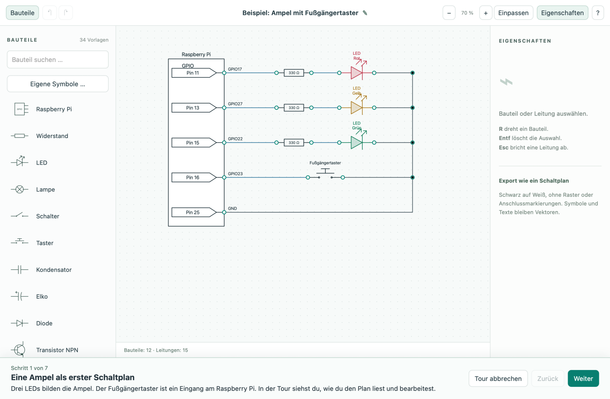
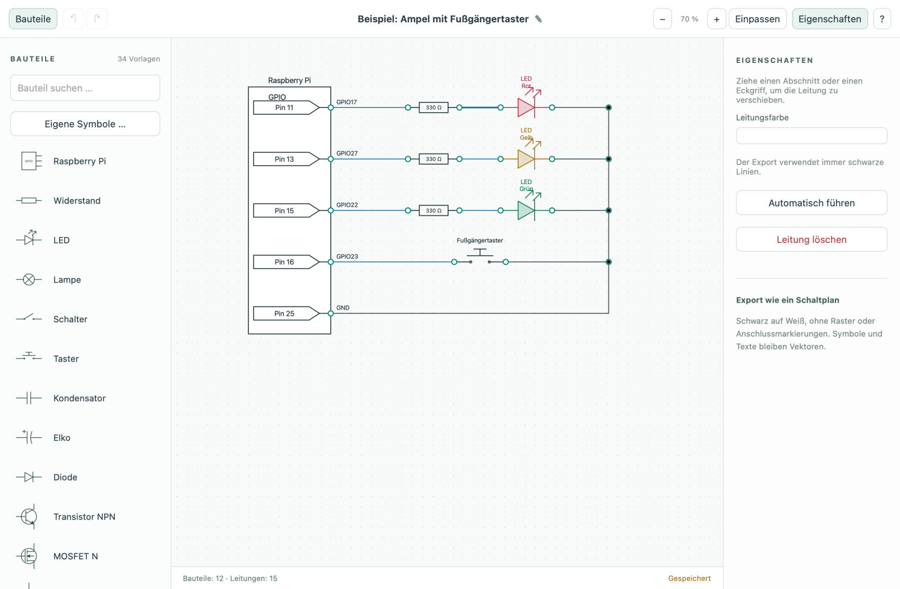
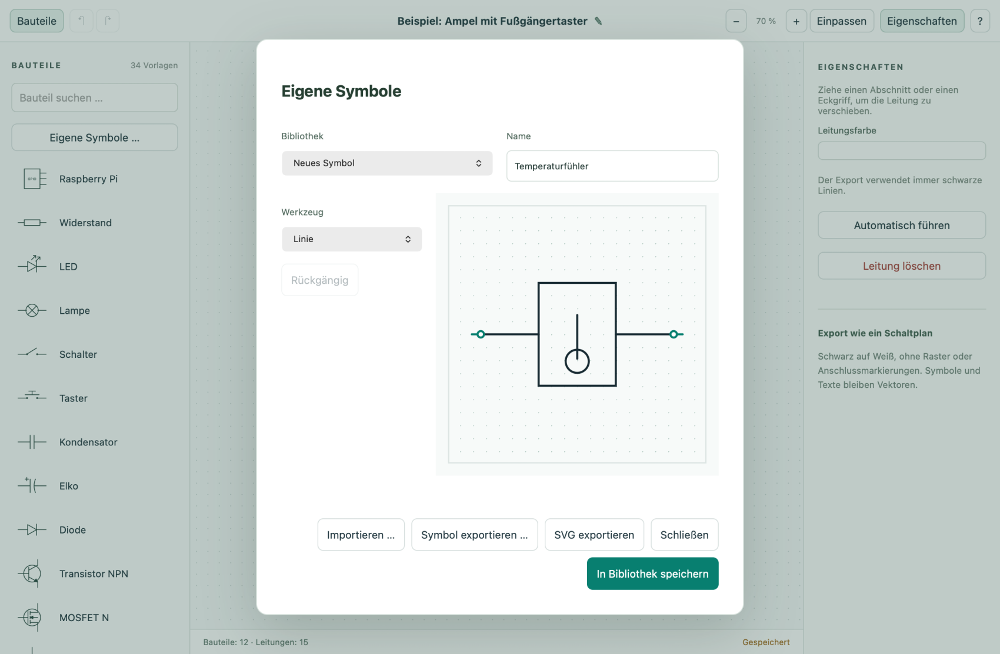

# PiWire 2.2.0 Benutzerhandbuch

[Zur Übersicht und zu den Downloads](../README.md) · [English](user-guide.md)

## 1. Start und Einführung

Öffne PiWire. Beim ersten Start siehst du die **Ampel mit Fußgängertaster**. Die sieben Schritte erklären den Aufbau, GPIO-Pins, Leitungen, Abzweige und den Export. **Esc** und **Tour abbrechen** beenden die Einführung jederzeit. Beim Erststart bleibt der Beispielplan danach bearbeitbar. Wiederholst du die Tour über **Einstellungen → Einführung starten**, kehrst du anschließend zu deinem aktuellen Plan zurück.

Beim normalen Folgestart und über **Ablage → Neu** (macOS) oder **Datei → Neu** (Windows/Linux) erscheint ein neuer Plan mit einem Raspberry Pi und allen 40 physischen Pins.

## 2. Bauteile und Beschriftungen

1. Wähle links ein Bauteil aus. Es erscheint auf der Zeichenfläche und lässt sich im Raster verschieben.
2. Klicke es an, um rechts seine Eigenschaften zu bearbeiten. Gib einen Namen und einen Wert ein und klicke **Übernehmen**.
3. Die Optionen **Name ausblenden** und **Wert ausblenden** steuern die Anzeige pro Bauteil. Widerstandswerte wie `4,7 kΩ` stehen im Widerstandssymbol. Bei LEDs öffnet **LED-Farbe** die Farbauswahl.
4. Beim Raspberry Pi lässt sich unter **Sichtbare Pins (physisch)** etwa `11, 13, 15, 16, 25` eintragen. `1-40` zeigt den ganzen Header. Beim Ausblenden eines angeschlossenen Pins wird dessen Leitung entfernt.
5. Klicke oben auf den Projekttitel, um ihn umzubenennen. Ein ausgewähltes Bauteil lässt sich mit dem Stift neben dem Namen oder per **F2** umbenennen.

Die Schaltflächen **Bauteile** und **Eigenschaften** in der oberen Leiste klappen die Seitenleisten ein. Ziehe eine freie Stelle des Rasters, um den Ausschnitt zu verschieben. Mit dem Mausrad zoomst du. **Einpassen** zeigt den ganzen Plan.

## 3. Leitungen und Knoten

- **Verbindung zeichnen.** Klicke einen Anschluss und anschließend den Zielanschluss an. Klicks ins Raster setzen Ecken. **Esc** beendet die laufende Verbindung.
- **Leitung verschieben.** Ziehe einen geraden Abschnitt quer zu seiner Richtung. Wähle die Leitung aus, um die Eckgriffe einzublenden und einzelne Ecken zu ziehen. Die Anschlüsse bleiben dabei fest.
- **Abzweig setzen.** Klicke beim Verkabeln auf eine vorhandene Leitung. PiWire setzt dort einen Verbindungsknoten. Mit **Shift-Klick** kannst du eine Verbindung auf einer vorhandenen Leitung beginnen.
- **Kreuzung lesen.** Ein Punkt markiert eine Verbindung. Eine kleine Lücke markiert eine Kreuzung ohne Verbindung.
- **Neu führen.** Wähle eine Leitung und klicke auf **Automatisch führen**, um ihre von Hand gesetzten Ecken zu verwerfen. Die Leitungsfarbe stellst du im selben Inspektor ein.

### Ampel-Beispiel lesen

Die drei LED-Zweige liegen übereinander. Jede LED hat einen eigenen 330-Ω-Widerstand und eine blaue Leitung zu einem anderen GPIO. Die dunkle Sammelleitung rechts verbindet die Rückleitungen mit GND am physischen Pin 25. Der Fußgängertaster bildet den vierten Zweig. **GPIO23 am physischen Pin 16** ist dabei der Eingang. Das Schaltbild zeigt die Verdrahtung. Die Steuerlogik der Ampel gehört in ein eigenes Programm.

[Bearbeitbare Ampelschaltung öffnen](../Source/Beispiel-Ampel.piwire)

## 4. Eigene Symbole

1. Öffne links **Eigene Symbole** und gib einen Namen ein.
2. Zeichne auf dem Raster Linien, Rechtecke und Ellipsen. Im Werkzeug **Anschluss** wählst du Namen und Richtung des Pins und setzt ihn mit einem Klick.
3. **In Bibliothek speichern** legt die Vorlage in der Bauteilpalette ab. Wähle eine vorhandene Vorlage im Feld **Bibliothek**, um sie zu öffnen.
4. **Symbol exportieren …** speichert eine bearbeitbare `.piwire-symbol`-Datei mit der Geometrie und den Anschlüssen. **Importieren …** nimmt sie auf einem anderen Rechner wieder auf.
5. **SVG exportieren** erstellt eine Vektorgrafik des Symbols. In einem Projekt eingesetzte Symbole werden samt Geometrie im Projekt gespeichert.

## 5. Speichern, öffnen und teilen

| Format | Verwendung |
| --- | --- |
| `.piwire` | Bearbeitbares Projekt mit Bauteilen, Anschlüssen und Leitungen |
| PDF | Auf eine A4-Seite eingepasster Schaltplan zum Weitergeben und Drucken |
| SVG | Skalierbarer Vektorexport für Doku und Weiterverarbeitung |
| `.piwire-symbol` | Einzelne bearbeitbare Symbolvorlage aus dem Symbol-Editor |

**Speichern unter …** bietet die drei Projekt- und Schaltplanformate an. PDF und SVG zeigen den Plan schwarzweiß, mit Verbindungsknoten und ohne Editorgriffe. Auf dem Mac registriert sich PiWire für `.piwire`. Finder verwendet die macOS-Dateizuordnung beim Doppelklick und kann die projektbezogene Miniatur anzeigen, wenn Symbolvorschauen aktiviert sind. Eine bestehende Zuordnung lässt sich im Finder unter **Informationen → Öffnen mit** prüfen.

Beim Schließen oder Projektwechsel fragt PiWire nach ungespeicherten Änderungen. PiWire speichert Änderungen auf Anforderung.

## 6. Tastenkürzel

| Aktion | Kürzel |
| --- | --- |
| Öffnen und speichern | **⌘ / Strg + O** und **⌘ / Strg + S** |
| Speichern unter | **⇧⌘ / Strg+Umschalt + S** |
| Kopieren, einfügen, duplizieren | **⌘ / Strg + C**, **V**, **D** |
| Rückgängig und wiederholen | **⌘ / Strg + Z**, **⇧⌘ / Strg+Umschalt + Z** |
| Umbenennen | **F2** |
| Drehen oder löschen | **R** oder **Entf** |
| Verbindung oder Einführung abbrechen | **Esc** |

## 7. Sprache, Updates und Hilfe

Unter **Einstellungen** wählst du Deutsch, Englisch oder die Systemsprache. Dort lässt sich auch die Prüfung auf GitHub-Releases beim Start konfigurieren. PiWire zeigt dir bei einem verfügbaren Update die passende Datei und die Installationsschritte. Die **PiWire-Hilfe** in der Menüleiste oder über **?** im Editor enthält den Schnellstart, die Leitungsbearbeitung und die wichtigsten Tastenkürzel.
