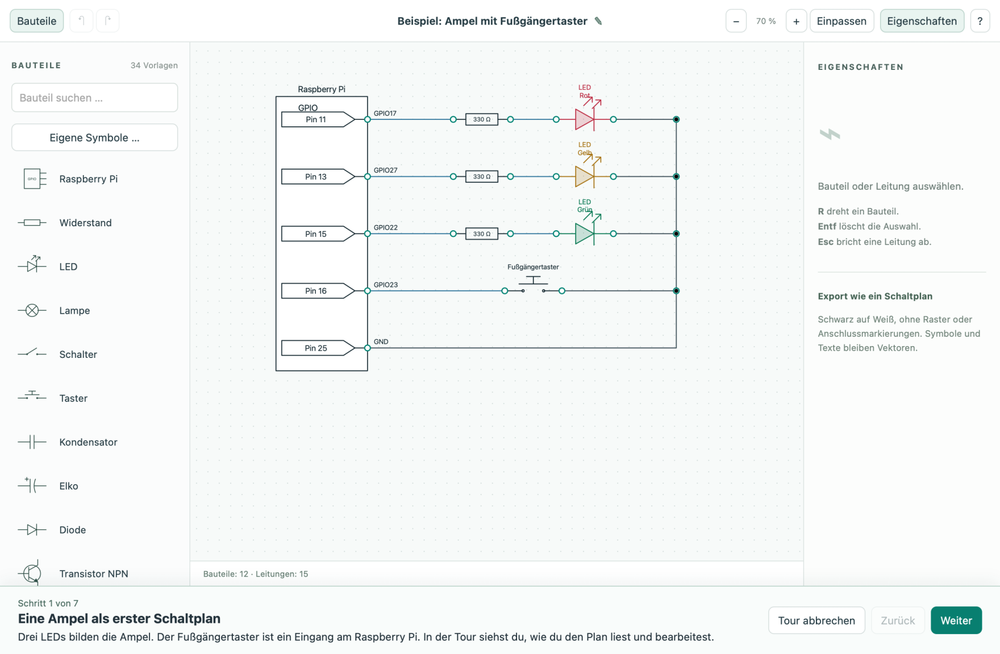
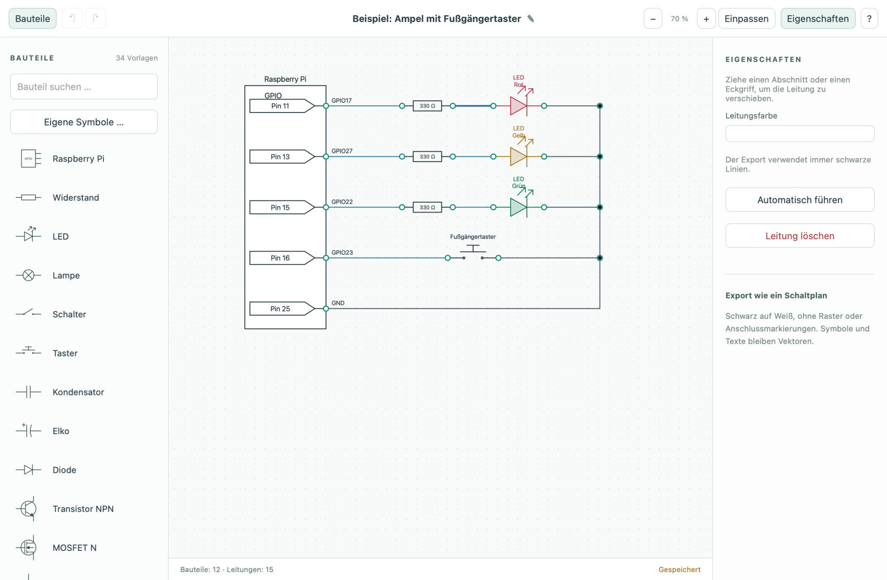
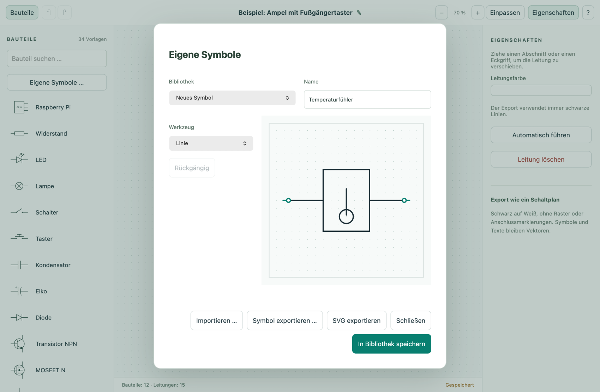

# PiWire 2.2.0

## Einführung und Arbeitsplatz

- **Erststart-Tour** mit sieben jederzeit abbrechbaren Schritten und einer bearbeitbaren Ampelschaltung.
- **Tour erneut starten** über die Einstellungen, mit Rückkehr zum aktuellen Projekt.
- **Neuer Schaltplan** mit Raspberry Pi und allen 40 physischen Pins.
- **Klappbare Seitenleisten**, kompakte Werkzeugleiste und Dateiaktionen in der nativen Menüleiste.
- **Direkt umbenennen** über den Projekttitel, im Bauteilinspektor oder per F2.
- **Hilfe nach Thema** mit Schnellstart und Tastenkürzeln.

## Schaltpläne und Bauteile

- **Leitungsbearbeitung** mit ziehbaren Segmenten und Eckgriffen, Leitung-zu-Leitung-Verbindungen, automatischen Knoten und getrennten Routen.
- **GPIO am Raster**, **Widerstandswerte im Schaltsymbol**, **einstellbare LED-Farben** und **einzeln ausblendbare Namen und Werte**.
- **Kopieren und Einfügen** für Bauteile über Strg+C / Strg+V oder ⌘C / ⌘V.
- **34 eingebaute Vorlagen**, darunter Spule, Transformator, Wechselschalter, Öffnerkontakt, Zenerdiode, Operationsverstärker, Voltmeter und Amperemeter.
- **Eigener Symbol-Editor** mit Linien, Rechtecken, Ellipsen und benannten Anschlüssen. Vorlagen lassen sich in der Palette speichern, als `.piwire-symbol` austauschen und als SVG exportieren.

## macOS und Downloads

- **Finder-Integration** für `.piwire` mit Dokument-Icon und Quick-Look-Miniatur.
- **macOS** als Universal-DMG, **Windows x64** als portables ZIP und **Linux x86-64** als TAR.GZ. Die SHA-256-Prüfsummen liegen beim Release.

## Screenshots

[Benutzerhandbuch](https://github.com/LordSteini/PiWire/blob/v2.2.0/docs/handbuch.md) · [Ampelschaltung als bearbeitbares Projekt](https://github.com/LordSteini/PiWire/blob/v2.2.0/Source/Beispiel-Ampel.piwire)

