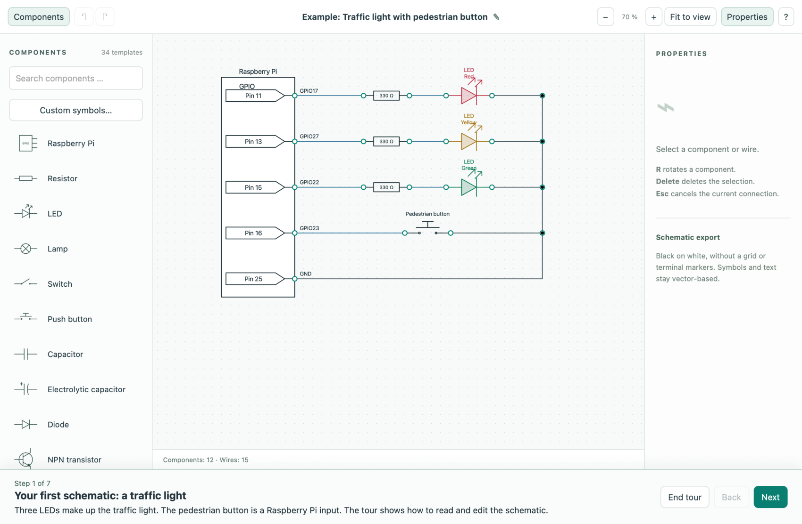
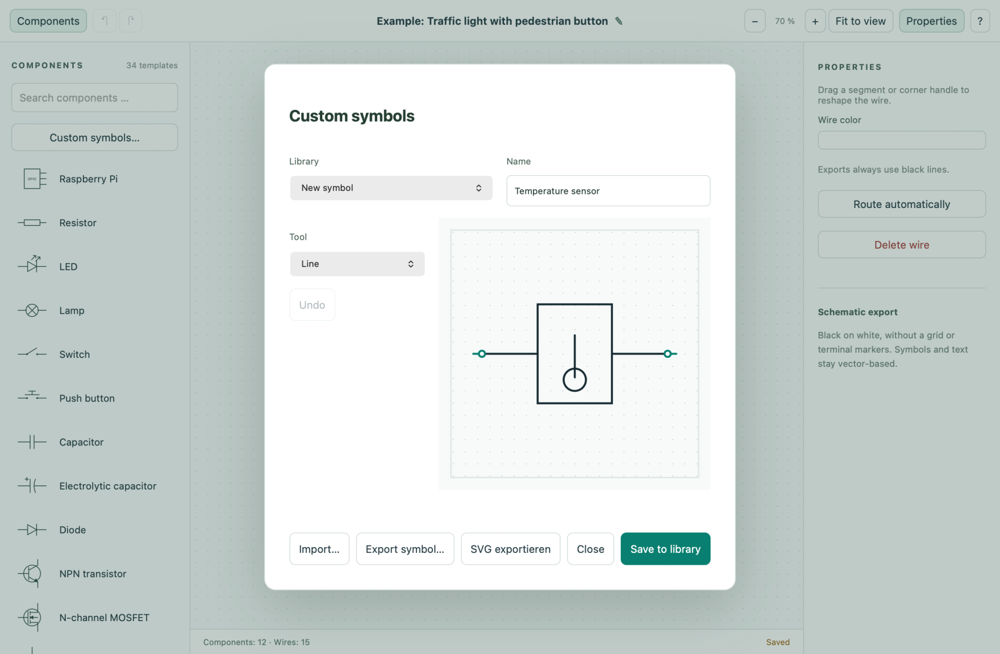

## Getting started and workspace

- **First-launch tour** with seven skippable steps and an editable traffic-light circuit.
- **Replay the introduction** from Settings and return to your current project afterward.
- **New schematics** start with a Raspberry Pi and all 40 physical header pins.
- **Collapsible sidebars**, a compact toolbar, and native file menus.
- **Quick renaming** from the project title, the component inspector, or with F2.
- **Topic-based help** with a quick start and keyboard shortcuts.

## Schematics and components

- **Wire editing** with draggable segments and corner handles, wire-to-wire connections, automatic junctions, and separated routes.
- **Grid-aligned GPIO**, **values inside resistor symbols**, **custom LED colors**, and independent controls for displaying names and values.
- **Copy and paste components** with Ctrl+C / Ctrl+V or ⌘C / ⌘V.
- **34 built-in templates**, including an inductor, transformer, changeover switch, normally closed contact, Zener diode, operational amplifier, voltmeter, and ammeter.
- **Custom symbol editor** with lines, rectangles, ellipses, and named terminals. Save templates in the palette, share them as `.piwire-symbol`, or export them as SVG.

## macOS and downloads

- **Finder integration** for `.piwire` files with a document icon and a Quick Look thumbnail.
- **Universal DMG for macOS**, **portable ZIP for Windows x64**, and **TAR.GZ for Linux x86-64**. SHA-256 checksums are included with the release.

## Screenshots

[English user guide](https://github.com/LordSteini/PiWire/blob/main/docs/user-guide.md) · [Editable traffic-light schematic](https://github.com/LordSteini/PiWire/blob/main/Source/Beispiel-Ampel.piwire)

