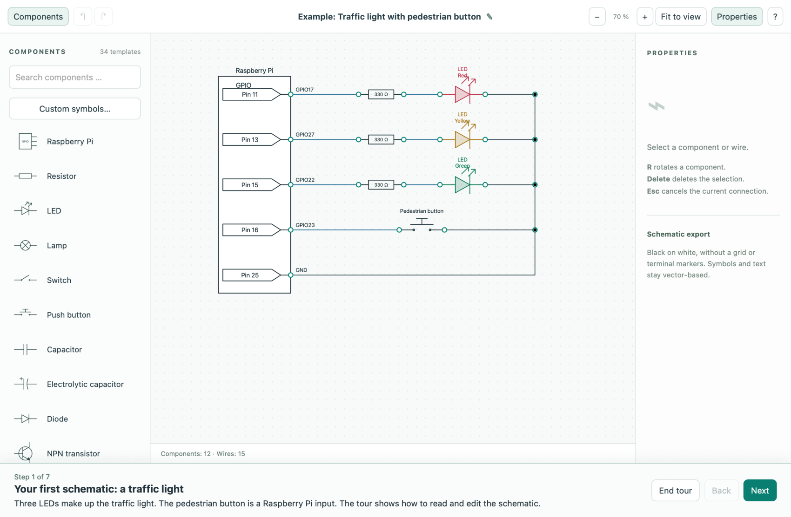
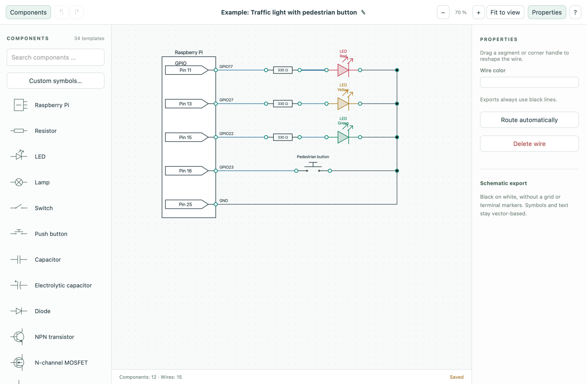
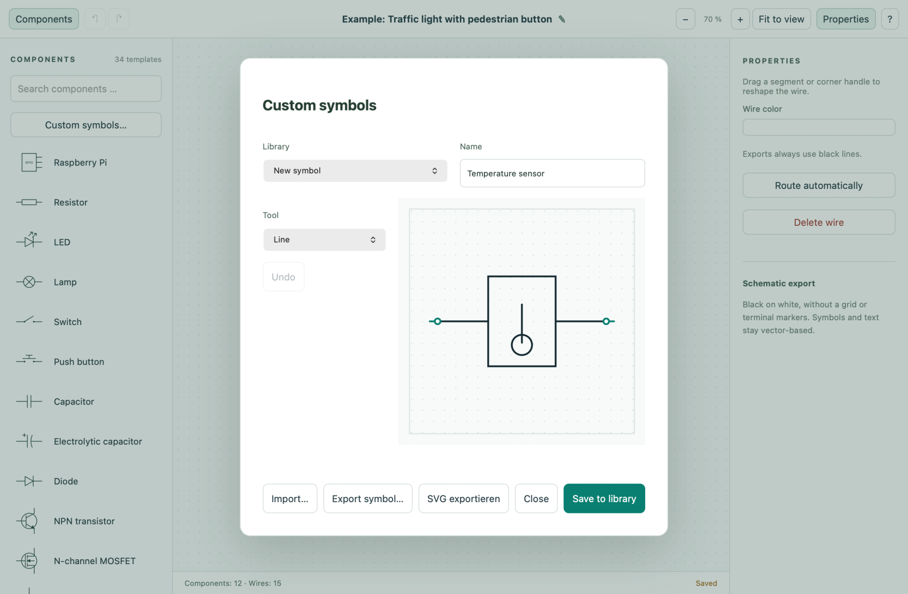

# PiWire 2.2.0 User Guide

[Downloads and repository overview](../README.md) · [Deutsch](handbuch.md)

## 1. Get started

The first launch opens **Traffic light with pedestrian button**. The seven-step introduction covers the schematic, GPIO pins, wiring, junctions, and export. Press **Esc** or select **End tour** at any step. The first-launch example stays open for editing. To repeat the introduction, select **Settings → Start introduction**. PiWire restores your current schematic when the repeated tour ends.

On later launches and when you select **File → New**, PiWire starts with a Raspberry Pi and all 40 physical header pins on the canvas.

## 2. Place and label components

1. Choose a component in the palette to add it to the canvas. Drag it to move it on the grid.
2. Select the component to edit its name and value in **Properties**, then select **Apply**.
3. Use **Hide name** and **Hide value** to control each label separately. Values such as `4.7 kΩ` appear inside the resistance symbol. Select **LED color** to change a diode’s display color.
4. On the Raspberry Pi, enter physical pin numbers such as `11, 13, 15, 16, 25`, or enter `1-40` to show the full header. Removing a connected pin also removes its wires.
5. Click the project title to rename the schematic. Use the pencil in a selected component’s properties or press **F2** to rename that component.

The **Components** and **Properties** buttons toggle the sidebars. Drag empty space to pan, use the mouse wheel to zoom, or select **Fit to view** to see the entire drawing.

## 3. Wire the schematic

- **Connect terminals.** Click a starting terminal and then a destination. Click the grid between them to place corners. **Esc** cancels the wire in progress.
- **Adjust a route.** Drag a straight section sideways. Select the wire to reveal individual corner handles. Terminals stay fixed while you drag the route.
- **Create a junction.** Click an existing wire as the destination. **Shift-click** an existing wire to start there.
- **Read crossings.** A dot marks a junction. A small gap marks a crossing where the wires remain separate.
- **Reroute a wire.** In its properties, select **Route automatically** to replace manually placed corners. Use the same inspector to change wire color.

### Read the traffic-light example

The three LED branches run in parallel on the drawing. Each LED has a separate 330 Ω resistor and a blue wire to a GPIO pin. The dark rail on the right connects all return lines to GND on physical pin 25. The pedestrian button is the fourth branch, with physical pin 16 (GPIO23) as the input. The drawing documents the wiring. The traffic-light behavior is defined in a separate control program.

[Download the editable traffic-light project](../Source/Beispiel-Ampel.piwire)

## 4. Draw and share custom symbols

1. Open **Custom symbols** from the palette and enter a name.
2. Draw lines, rectangles, and ellipses. Select **Terminal** to name a pin, choose its direction, and place it on the grid.
3. Select **Save to library** to add the template to your local palette. Use the library selector to reopen an existing template.
4. Use **Export symbol** to share an editable `.piwire-symbol` file. Use **Import** to restore the geometry and terminals on another computer.
5. Use **Export SVG** for a vector version of the symbol. PiWire includes the geometry of placed custom symbols in the project file.

## 5. Save, open, and export

| Format | Use |
| --- | --- |
| `.piwire` | Editable schematic with components, terminals, and wires |
| PDF | Schematic fitted to an A4 page for sharing or printing |
| SVG | Scalable vector drawing for reuse |
| `.piwire-symbol` | Editable component template from the symbol editor |

**Save As** offers project, PDF, and SVG formats. PDF and SVG use monochrome drawing lines, retain junctions, and omit editor controls. On macOS, double-click a `.piwire` file in Finder to open it with the assigned app. For a project thumbnail, enable **Show icon preview** in Finder. **Get Info → Open with** shows which app macOS has assigned.

PiWire requests a decision before closing or switching away from a project with unsaved changes. Save explicitly to write your latest edits to disk.

## 6. Keyboard shortcuts

| Action | Shortcut |
| --- | --- |
| Open and save | **⌘ / Ctrl + O** and **⌘ / Ctrl + S** |
| Save As | **⌘ / Ctrl + Shift + S** |
| Copy, paste, or duplicate | **⌘ / Ctrl + C**, **V**, or **D** |
| Undo or redo | **⌘ / Ctrl + Z** or **⌘ / Ctrl + Shift + Z** |
| Rename | **F2** |
| Rotate or delete | **R** or **Delete** |
| Cancel wiring or end the tour | **Esc** |

## 7. Language, updates, and help

In **Settings**, choose English, German, or the system language. Settings also controls GitHub update checks at launch. When a newer version is available, PiWire offers the package for your platform and shows installation instructions. **PiWire Help** in the menu bar or **?** in the editor opens the quick start, wiring instructions, and shortcuts.
